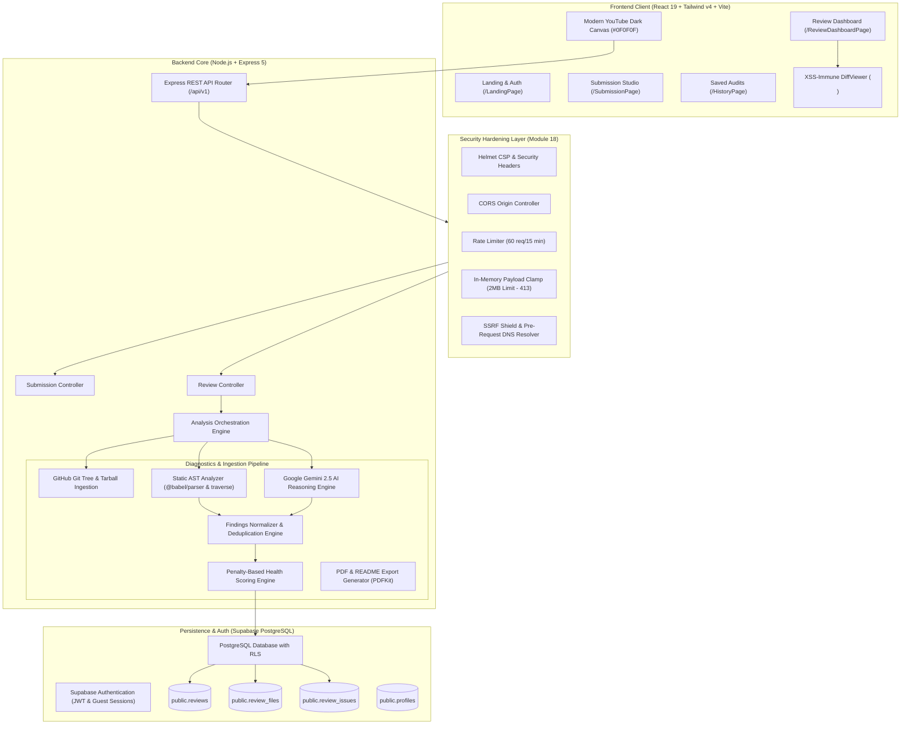
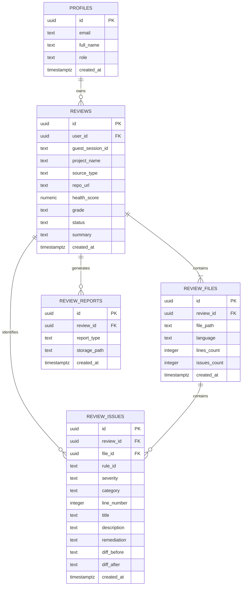

# Re:Code System Architecture & Technical Specification

> **Read. Review. Refine.**  
> Automated Code Diagnostics, Static AST Security Analysis, and Generative AI Review Platform.

---

## 1. Architectural Overview & System Design

**Re:Code** is an enterprise-grade automated code review platform designed to bridge the gap between deterministic static analysis (Abstract Syntax Tree parsing) and contextual semantic reasoning (Large Language Model diagnostics). By synthesizing Babel AST syntax traversal with Google Gemini generative models, Re:Code eliminates false positives while identifying deep architectural bugs, injection vulnerabilities, and performance bottlenecks.



---

## 2. Monorepo Organization

The project is structured as an npm workspaces monorepo, maintaining strict separation of concerns between client interface and backend services while sharing root-level tooling and environment variables.

```
recode-app/
├── package.json              # Monorepo root scripts (dev:all, test:all, build:all)
├── package-lock.json
├── .env                      # Unified environment variables
├── .env.example              # Template for secret configuration
├── docs/                     # Architectural, operational, and academic documentation
│   ├── ARCHITECTURE.md
│   ├── SETUP_GUIDE.md
│   └── PROJECT_REPORT_APPENDIX.md
├── backend/                  # REST API & Analysis Engine
│   ├── package.json
│   ├── server.js             # HTTP server entry point (Port 5000)
│   ├── src/
│   │   ├── app.js            # Express application initialization & middleware stack
│   │   ├── config/           # Supabase & environment configuration
│   │   ├── controllers/      # REST endpoint controllers (submission, review)
│   │   ├── db/               # PostgreSQL migrations & database seeding
│   │   ├── middleware/       # Security, SSRF shield, error handlers, payload clamps
│   │   ├── routes/           # REST route definitions (/api/v1/...)
│   │   ├── services/         # AST parser, AI reviewer, orchestrator, PDF generator
│   │   └── utils/            # Validators, API responses, custom AppError
│   └── tests/                # Jest automated regression test suite (13 suites, 187 tests)
├── frontend/                 # React 19 Client Application
│   ├── package.json
│   ├── vite.config.js        # Vite 8 config with Rolldown code-splitting
│   ├── tailwind.config.js    # Design tokens & color system
│   ├── public/               # Static assets & official logo (Logo.svg, favicon)
│   └── src/
│       ├── App.jsx           # Client router and route definitions
│       ├── index.css         # YouTube Dark Mode design tokens and base styles
│       ├── components/       # Atomic UI components (Navbar, Footer, PillBadge, DiffViewer)
│       ├── pages/            # 4 Core pages (Landing, Submission, Dashboard, History)
│       ├── services/         # Supabase client & API services
│       ├── utils/            # Client-side XSS sanitizers
│       └── views/            # Design system component showcase
└── scratch/                  # Integration verification scripts
    └── verify_all_modules.mjs
```

---

## 3. Security Hardening Layer (Module 18)

Re:Code implements defense-in-depth across the entire request-response lifecycle:

### 3.1 Comprehensive SSRF Shield
Before issuing outbound requests to remote targets (e.g. GitHub API or repositories), the system validates and resolves target hostnames:
1. **Pre-Request DNS Resolution**: Uses `dns.promises.lookup(hostname, { all: true })` to resolve all IPv4 and IPv6 records.
2. **Private IP Blacklisting**: Any target resolving to private or link-local address spaces is rejected with HTTP 400:
   * `10.0.0.0/8` (Class A Private Network)
   * `172.16.0.0/12` (Class B Private Network: `172.16.0.0` - `172.31.255.255`)
   * `192.168.0.0/16` (Class C Private Network)
   * `127.0.0.0/8` (IPv4 Loopback)
   * `169.254.0.0/16` (Cloud Metadata / Link-Local, e.g. `169.254.169.254`)
   * `0.0.0.0/8` (Unspecified address)
   * `100.64.0.0/10` (Carrier-Grade NAT)
   * `::1`, `fe80::/10`, `fc00::/7` (IPv6 Loopback, Link-Local, Unique-Local)
   * `::ffff:0:0/96` (IPv4-mapped IPv6)
3. **Numeric & Obfuscated IP Defense**: Resolves decimal integers (`http://2130706433`), hex addresses (`0x7f000001`), and octal notation (`0177.0.0.1`).
4. **Internal TLD Filtering**: Rejects `.internal`, `.local`, `.corp`, `.intranet`, `.home`, and `.arpa`.
5. **DNS Rebinding Defense**: Inspects all resolved IP addresses immediately prior to fetch execution.

### 3.2 In-Memory Payload Size Clamps
To protect backend worker threads and memory allocations against buffer-overflow and denial-of-service attempts:
* Evaluates `Content-Length` headers before streaming bodies.
* Evaluates buffered in-memory request byte length.
* Requests exceeding **2MB** (`2,097,152 bytes`) are rejected immediately with **HTTP 413 Payload Too Large**.

### 3.3 Strict CORS & Content Security Policy
* CORS is restricted to authorized origins (defaults to `http://localhost:5173` with credentials).
* Helmet CSP enforces strict `default-src 'self'`, forbidding unsafe inline scripts in production.

---

## 4. Static AST Analysis & Heuristic Engine

The AST analysis engine evaluates source code deterministically without executing unverified code:
* **Parser Engine**: Utilizes `@babel/parser` with language plugins (JSX, TypeScript, decorators, class properties).
* **Syntax Error Isolation**: If unclosed brackets or syntax errors are detected, the system generates an informative `#AST-SYNTAX` diagnostic card with exact line numbers rather than crashing the pipeline.
* **Rule Definitions**:
  * `security/sql-concatenation` (CWE-89 / OWASP A03:2021): Detects dynamic string concatenations inside database query methods.
  * `security/jwt-hardcoded-secret` (CWE-798): Flags hardcoded secret strings passed to signing algorithms.
  * `security/insecure-eval` (CWE-95): Identifies dynamic code evaluation primitives (`eval`, `Function`).
  * `performance/sync-fs-in-loop` (CWE-400): Detects blocking I/O calls inside iteration blocks.
  * `quality/missing-error-handling` (CWE-390): Identifies unhandled Promises or empty catch blocks.

---

## 5. Google Gemini AI Diagnostics Pipeline

Static analysis provides high recall for syntax patterns, while Google Gemini generative intelligence provides semantic reasoning and automated patch generation:
* **Model**: Google Gemini 2.5 Flash / Flash Lite (`gemini-2.5-flash`).
* **Prompt Schema**: Enforces structured JSON output matching exact review schemas (`findings`, `title`, `ruleId`, `severity`, `description`, `remediation`, `diff_before`, `diff_after`).
* **Dual-Engine Fusion**:
  1. AST scanner produces initial rule-based violations.
  2. Gemini evaluates repository architecture and suggests contextual refactorings.
  3. `findingsNormalizer.js` deduplicates findings based on line proximity and rule matching, assigning a confidence rating.
  4. Resilient Fallback: If network interruption or rate limiting occurs on the Gemini API, the pipeline seamlessly falls back to static AST findings with zero user disruption.

---

## 6. Health Scoring Engine (Module 10)

The code health score is computed deterministically on a 0-100 integer scale:
$$\text{Score} = \max\left(0, 100 - \sum \text{Severity Penalties}\right)$$

| Severity Tier | Penalty Points | Description |
| :--- | :---: | :--- |
| **CRITICAL** | 25 pts | Exploitable vulnerabilities (SQLi, hardcoded secrets, RCE) |
| **HIGH** | 15 pts | High-risk logic flaws, unhandled exceptions, parser errors |
| **MEDIUM** | 8 pts | Security code smells, performance bottlenecks |
| **LOW** | 3 pts | Lint issues, naming conventions, minor optimizations |
| **INFO** | 0 pts | Architecture notes, best practices |

### Letter Grade Scale
* **Grade A**: $90 - 100$ (Production Ready)
* **Grade B**: $80 - 89$ (Minor Refinements Recommended)
* **Grade C**: $70 - 79$ (Moderate Security Debt)
* **Grade D**: $60 - 69$ (Significant Vulnerabilities Present)
* **Grade F**: $< 60$ (Deployment Blocked)

---

## 7. Database Architecture & PostgreSQL Schema

Persisted in Supabase PostgreSQL with full Row Level Security (RLS):



### Table Definitions & Constraints
1. **`public.profiles`**: Synchronized automatically with `auth.users` via PostgreSQL triggers on signup.
2. **`public.reviews`**: Root audit entity. Constrained by `chk_review_owner`: requires either `user_id IS NOT NULL` OR `guest_session_id IS NOT NULL`.
3. **`public.review_files`**: Files scanned within a review session. Foreign key `review_id` cascades on deletion.
4. **`public.review_issues`**: Individual security flaws and patches. Cascades on review deletion.
5. **`public.review_reports`**: Metadata for generated audit artifacts (PDF reports and README badges).

### Row Level Security (RLS) Strategy
* **Authenticated Access**: `auth.uid() = user_id`
* **Guest Sandbox Access**: `guest_session_id = current_setting('request.headers', true)::json->>'x-guest-session-id'`
* Direct client writes are prevented; all insertions are managed securely through the authenticated backend repository layer (`reviewRepository.js`).

---

## 8. Frontend Design System & Diff Viewer

The frontend adheres strictly to the zero-glow, matte **YouTube Dark Mode** palette:

* **Canvas Surface**: `#0F0F0F`
* **Card & Navbar Surface**: `#181818`
* **Inputs & Dividers**: `#212121`, `#303030`, `#3F3F3F`
* **Brand Code Cyan**: `#02C8F0`
* **Severity Colors**:
  * Critical: `#FF4D4D`
  * High: `#FFA116`
  * Medium: `#FFD600`
  * Low: `#78DFFF`
  * Clean / Pass: `#27C93F`

### XSS-Immune DiffViewer Component
* Renders code diffs inside semantic `<pre className="..."><code>{sanitizedText}</code></pre>` text nodes.
* Completely eliminates dangerous `innerHTML` and `dangerouslySetInnerHTML`.
* Supports 1-click patch application, copy fix, and interactive line numbering.
